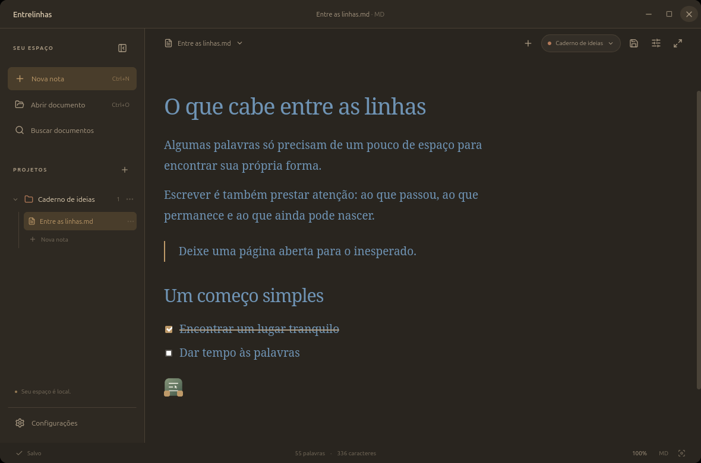
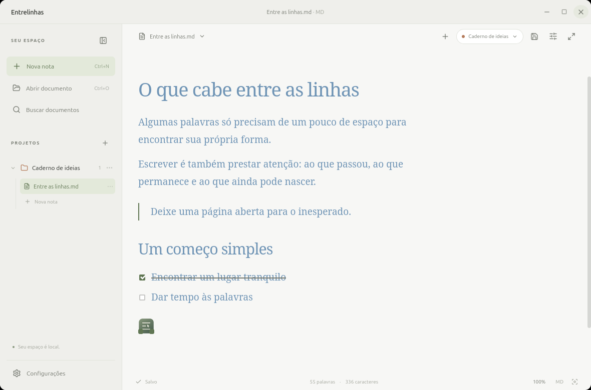
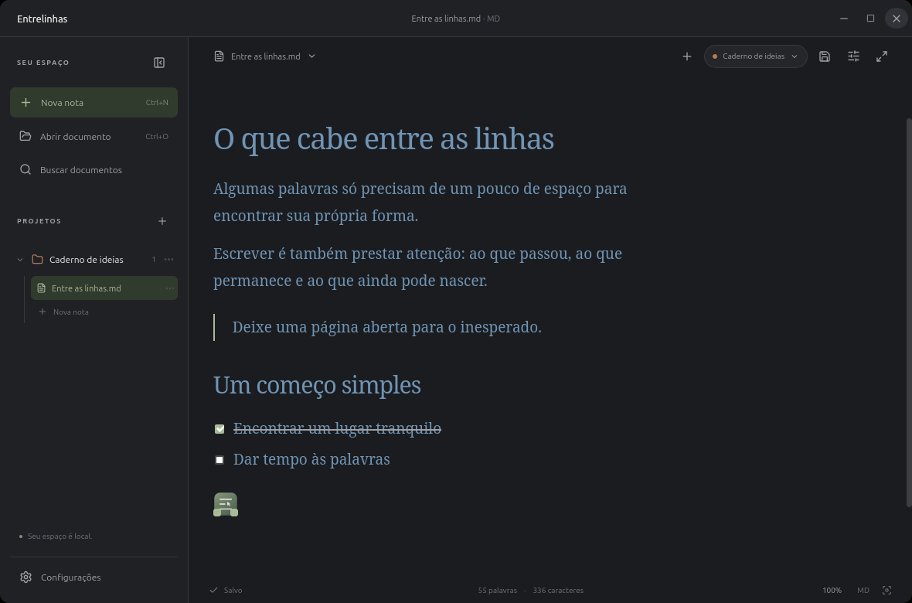
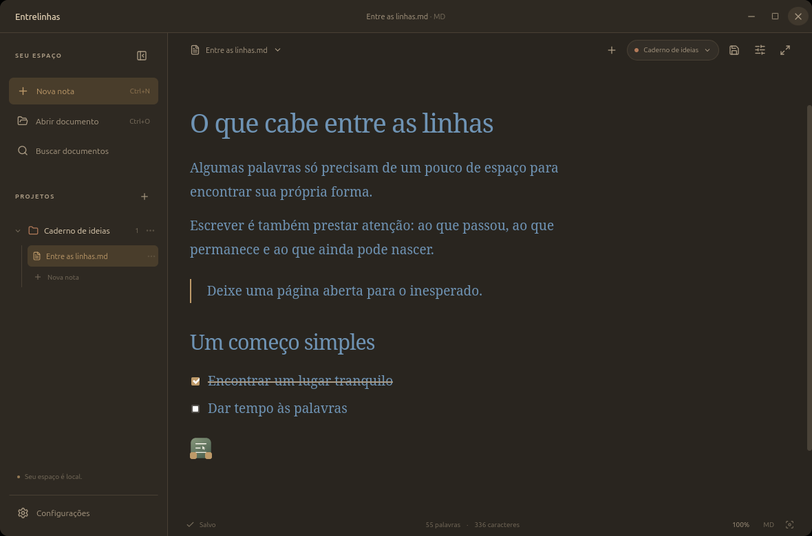

# Entrelinhas

**Um espaço tranquilo para escrever.**

Entrelinhas é um editor **desktop de verdade**, feito com Tauri 2, React e TypeScript para Ubuntu e Windows. Ao começar a digitar, o modo Zen recolhe a navegação e aproveita a altura da janela, mantendo a coluna de texto e as ferramentas de formatação. Esc alterna o modo Zen.



## Prévia 2.4: idiomas agrupados e ajustes de escrita

A [2.4.0-rc.1](https://github.com/Davi-Mascarenhas/entrelinhas/releases/tag/v2.4.0-rc.1) está disponível para avaliação. A versão estável continua sendo a 2.3.0.

Os idiomas agora aparecem em seis grupos. **Português** abre Brasil/Portugal, **Español** abre Latinoamérica/España e **中文** abre 简体中文/繁體中文. Inglês, japonês e alemão continuam disponíveis. As nove variantes traduzem a interface, os comandos e os avisos, preservando o conteúdo dos documentos. O Windows oferece os mesmos grupos e variantes no wizard; no Linux, a escolha continua na primeira das quatro telas iniciais. A escrita tradicional usa uma fonte local própria.

Ctrl+clique confirma o envio do link ao navegador, com aviso visível também no Zen e proteção de dois segundos contra aberturas repetidas. O cursor é preservado. A lateral dos projetos chega ao fim da janela, o rodapé fica na área do editor e a barra de formatação continua centralizada na tela inteira. O seletor lateral mostra o ícone completo. O recuo superior do Zen passa a 56 px; a barra lateral de formatação começa a 48 px do alto.

[Capturas, validação e limites da prévia](docs/preview-2.4.md).

## Versão 2.3 estável

A [versão 2.3.0](https://github.com/Davi-Mascarenhas/entrelinhas/releases/tag/v2.3.0) reúne as correções das prévias e está disponível para Windows e Linux.

- **Esc** alterna o modo Zen com o foco dentro do editor. Busca, menus e edição recebem a tecla primeiro.
- Links aceitam endereços como `exemplo.com`. Passar o mouse ou clicar mostra uma prévia local; **Ctrl+clique** abre no navegador padrão. A prévia não consulta a internet.
- Zoom do texto de **50% a 200%** pelo botão, teclado, **Ctrl+scroll** ou pinch, mantendo o tamanho dos controles.
- Barra de formatação inferior centralizada na janela, sem quebrar em várias linhas, e rolagem do próprio app na posição lateral. As configurações mostram prévias das duas posições.
- Atualizações continuam manuais. Uma estável mais nova tem prioridade; pré-releases têm aviso vermelho e **Esperar versão estável** como ação principal. Apenas a ação secundária explícita baixa a prévia.

O menu `/` oferece **20 comandos** nos cinco idiomas, incluindo listas recolhíveis, caixas informativas, avisos, imagens, links, data/hora, duplicar bloco e limpar formatação. [Lista completa](docs/slash-commands.md).

Os relatórios e capturas da auditoria acompanham a release. [Cobertura e limites dos testes](docs/validation-2.3.0.md).

## Comandos de escrita e modo Zen

Digite `/` no início de uma linha ou após um espaço. Continue digitando para filtrar, use as setas e Enter ou clique na opção. Esc fecha o menu e mantém o texto; desfazer restaura o comando.

| Idioma | Lista de tarefas | Tabela |
| --- | --- | --- |
| Português | `/lista` | `/tabela` |
| English | `/list` | `/table` |
| 日本語 | `/リスト` | `/テーブル` |
| 简体中文 | `/清单` ou `/列表` | `/表格` |
| Deutsch | `/liste` | `/tabelle` |

O menu acompanha o cursor durante a entrada automática no Zen. Não aparece dentro de links ou código e funciona offline.

A paleta de cores abre junto ao botão e aplica a escolha imediatamente, preservando a seleção. Duplo clique no título permite editar o nome na própria barra: Enter confirma e Esc cancela. Mudar de documento cancela uma edição ainda não confirmada; salvar e fechar aguardam uma renomeação já confirmada.

O modo Zen usa mais altura e suaviza o texto nas bordas superior e inferior. **Esc entra e sai quando há conteúdo**; menus e campos abertos recebem Esc primeiro. Em **Configurações → Barra de formatação**, escolha a posição inferior ou lateral e se deseja ocultar as ferramentas no Zen. Por padrão, elas continuam visíveis. Na lateral, ficam sempre do lado oposto aos projetos. As animações respeitam movimento reduzido.

[Menu de comandos](docs/screenshots/slash-pt-BR.png) · [日本語](docs/screenshots/slash-ja.png) · [简体中文](docs/screenshots/slash-zh-CN.png) · [Paleta imediata](docs/screenshots/color-anchored.png) · [Zen com mais altura](docs/screenshots/zen-height.png) · [Formatação lateral](docs/screenshots/formatting-side-right.png).

## Idiomas e atalhos

A interface está disponível em português brasileiro, inglês, japonês, chinês simplificado e alemão no Windows e no Linux.

No Windows, o idioma é escolhido na primeira janela do assistente de instalação e
usado na primeira abertura. As três telas seguintes apresentam o aplicativo, o tema
e a escolha opcional de aplicativo padrão. No Linux, a apresentação tem quatro telas:
idioma, boas-vindas, tema e aplicativo padrão. Instalações existentes preservam suas
preferências e não repetem a apresentação.

O idioma pode ser alterado em **Configurações → Linguagem**. A mudança é imediata e
não traduz nomes de projetos, arquivos ou conteúdo dos documentos. As fontes dos
menus japoneses e chineses acompanham o aplicativo e funcionam offline.

**Ctrl+,** abre as configurações, inclusive durante o modo Zen. Em
**Configurações → Atalhos**, clique em uma combinação, pressione as novas teclas e
clique em **Salvar**. Duplicatas e combinações reservadas são recusadas. **Esc** cancela
a captura. As dicas e os menus passam a exibir a combinação escolhida.

[Idiomas nas configurações](docs/screenshots/language-pt-BR.png) · [English](docs/screenshots/language-en.png) · [日本語](docs/screenshots/language-ja.png) · [简体中文](docs/screenshots/language-zh-CN.png) · [Deutsch](docs/screenshots/language-de.png) · [Idioma na primeira abertura](docs/screenshots/welcome-language.png) · [Personalizar atalho](docs/screenshots/shortcut-capture.png).

## Suas palavras, no seu tempo

- Inicialização normal em uma nota nova, vazia e mantida em memória. Ao abrir pelo explorador, recebe os documentos solicitados. Escrita sem o cabeçalho decorativo, começando mais acima.
- Tamanho e maximização da janela lembrados ao reabrir. Duplo clique nas áreas livres dos dois lados da barra maximiza ou restaura. O arraste só começa ao mover o mouse pressionado.
- Duplo clique no título permite editar o nome na própria barra: rascunhos ganham um nome sugerido; arquivos salvos são renomeados na mesma pasta, sem salvar as alterações do editor nem substituir outro arquivo.
- **Nenhum salvamento automático, recuperação de rascunhos ou restauração de abas.**
- Salvamento manual em arquivos Markdown e TXT comuns, em qualquer pasta. Abertura e salvamento pelo explorador do desktop via XDG Desktop Portal; no GNOME, utiliza o Nautilus. Os diálogos começam na pasta Documentos configurada no sistema; Salvar como mantém o caminho do arquivo aberto.
- Integração com **Abrir com** para `.md`, `.markdown` e `.txt`. Novos pedidos chegam à janela já aberta, preservam rascunhos e ativam documentos existentes sem duplicar guias.
- Projetos lógicos com nome, cor, ícone opcional e referências a documentos externos.
- [A lateral](docs/screenshots/projects-only.png) oferece acesso rápido somente aos arquivos vinculados a projetos. Arquivos avulsos podem ser abertos e salvos normalmente; vincular ou desvincular um projeto não modifica o arquivo no disco.
- Guias ocultas com uma única nota; botão **Nova guia** e **Ctrl+T** revelam a faixa ao abrir a segunda. Guias reordenáveis, com conteúdo, seleção e histórico preservados ao alternar.
- Modo Zen automático, alternância manual, acesso por Esc e aproximação das bordas.
- Apresentação inicial com idioma, boas-vindas, tema e aplicativo padrão opcional no Linux; no Windows, o idioma vem do instalador e a apresentação tem três páginas. Temas Claro, Escuro e Sépia Noturno, com prévia imediata e respeito às preferências de instalações anteriores.
- Coluna de escrita centralizada na janela inteira, com limite de largura e posição estável ao esconder os controles.
- Seletores próprios para projeto, cor, fonte, formato, layout e formatação, acompanhando os três temas. A paleta de cores é um painel local; diálogos de configurações e projetos preservam o fundo desfocado.
- Formatação na parte inferior ou na lateral, com botões sem moldura, e dicas temáticas com nomes e atalhos ao passar o mouse ou navegar pelo teclado.
- Cursor em bloco, fino ou invisível; fonte, tamanho, largura, zoom e entrelinha configuráveis.
- Navegação à esquerda ou à direita, redimensionável; abas superiores ou laterais. Em janelas estreitas, as abas voltam ao topo para manter uma coluna confortável.
- Busca e substituição no documento; busca por nome e conteúdo nos arquivos salvos registrados.
- Funcionamento local e offline, sem conta, servidor ou sincronização obrigatória.
- Atualizações manuais em **Configurações → Sobre**, com autorização de rede a cada consulta. No Windows, baixa, verifica e instala; no Linux, salva o `.deb` verificado para instalação pelo sistema. Sem consultas na inicialização ou avisos automáticos.

## Salvamento e privacidade

**Ctrl+S é uma decisão sua.** Um rascunho não é escrito em SQLite, localStorage, arquivos de sessão ou mecanismos de recuperação. Ao fechar sem salvar, ele é descartado. Alterações em arquivos existentes também dependem de salvamento manual.

A confirmação antes de descartar vem **desativada**, como preferência inicial. É possível ativá-la em **Configurações → Comportamento**. Nesse caso, as opções são salvar, descartar ou cancelar. Uma gravação manual já solicitada termina antes de a janela fechar.

O SQLite armazena somente projetos, referências a arquivos e preferências. Uma nota nova pode ter um projeto escolhido, mas sua associação só se torna persistente depois de salvar. Remover uma associação ou excluir um projeto **preserva os arquivos físicos**. Arquivos movidos podem ser localizados novamente pelo seletor do sistema.

As gravações usam arquivo temporário na pasta de destino, sincronização e renomeação atômica. Esses temporários existem apenas durante uma ação explícita de salvar. O aplicativo verifica o conteúdo do arquivo com SHA-256 para detectar alterações externas e pede uma decisão antes de substituir. Arquivos somente leitura, caminhos ausentes, permissões e codificações incompatíveis geram erros visíveis.

## Editor e formatos

O editor usa TipTap/ProseMirror, com desfazer/refazer, composição de texto, Unicode e quebra automática de linhas. Os botões de formatação ficam na parte inferior ou na lateral oposta aos projetos, sem uma moldura ao redor. O botão de ajustes no documento revela as ferramentas completas; selecionar texto revela os controles essenciais no mesmo lugar.

Suporta negrito, itálico, sublinhado, tachado, títulos, listas, checklists interativas, citações, código, links, separadores, alinhamento, destaque, cores, tamanho de texto, imagens e tabelas com edição de linhas e colunas.

O formato inicial é `.md`. Altere para `.txt` em **Configurações → Arquivos**. O seletor **Salvar como** também permite escolher o formato para cada arquivo. A aparência e os controles do explorador seguem o desktop; o pacote inclui as dependências do portal e o Zenity como alternativa.

- **Markdown:** títulos, listas, links, código e demais elementos comuns usam sintaxe Markdown. Cor, tamanho, sublinhado, alinhamento, tabelas e tarefas utilizam HTML compatível dentro do Markdown quando necessário para manter a formatação reversível.
- **TXT:** contém somente texto UTF-8. Antes de exportar conteúdo formatado, o aplicativo avisa sobre a perda de formatação e imagens. O editor aberto mantém a versão rica até ser fechado.
- Arquivos `.markdown` também podem ser abertos. Arquivos em outras codificações devem ser convertidos para UTF-8 antes da abertura.

### Imagens

Insira pelo botão de imagem, arrastando um arquivo para o editor ou colando uma imagem da área de transferência quando o sistema a disponibilizar. As imagens são redimensionáveis pelos cantos.

Rascunhos mantêm as imagens **apenas em memória**. Ao salvar `Minha nota.md`, os recursos ficam em `Minha nota.assets/`, ao lado do arquivo, com referências relativas e nomes derivados do conteúdo. Ao usar **Salvar como**, as imagens carregadas são copiadas para os recursos do novo documento. Ao mover um Markdown, leve também a pasta de recursos.

Formatos: PNG, JPEG, GIF, WebP, AVIF e BMP. Imagens remotas não são baixadas automaticamente. Imagens indisponíveis geram aviso; referências são preservadas. Recursos de documentos já salvos não são apagados automaticamente quando deixam de ser usados.

## Temas

As capturas abaixo são da janela Tauri real, executada no Ubuntu 26.10 com Wayland. O texto apresentado foi criado somente para os testes e não acompanha a inicialização do aplicativo.

| Claro                                | Escuro                               | Sépia Noturno                                |
| ------------------------------------ | ------------------------------------ | -------------------------------------------- |
|  |  |  |

[Ver o modo Zen](docs/screenshots/imersivo.png) · [Boas-vindas](docs/screenshots/welcome.png) · [Escolha inicial de tema](docs/screenshots/welcome-theme.png) · [Escolha de aplicativo padrão](docs/screenshots/welcome-default.png) · [Padrão nas configurações](docs/screenshots/default-app.png) · [Seletor de cores no Sépia Noturno](docs/screenshots/color-sepia.png) · [Seleção de projeto](docs/screenshots/project-picker.png) · [Menus temáticos](docs/screenshots/select-sepia.png) · [Formatação inferior](docs/screenshots/formatting-bottom.png) · [Dicas de botões](docs/screenshots/tooltip-sepia.png) · [Edição do título](docs/screenshots/rename-title.png) · [Busca com mais espaço](docs/screenshots/search-spacing.png) · [Página inicial sem cabeçalho](docs/screenshots/blank.png).

Os menus de seleção e as dicas usam as cores do tema do aplicativo. Os seletores de opções permitem navegar com setas, Home/End, digitar o início do nome e confirmar com Enter; Esc cancela a seleção sem fechar as configurações. Os diálogos do sistema para abrir e salvar arquivos acompanham o modo claro ou escuro; Sépia Noturno usa a variante escura do GTK.

O cursor em bloco usa as coordenadas reais da seleção do ProseMirror e a largura do próximo grafema. Durante composição IME, a camada visual cede ao cursor nativo. Preferências de movimento reduzido são respeitadas.

## Instalação no Windows

O instalador **Entrelinhas 2.3.0 para Windows x64** usa NSIS, com logo, artes em sépia e cinco idiomas. Está disponível na [release estável](https://github.com/Davi-Mascarenhas/entrelinhas/releases/tag/v2.3.0), junto com o SHA-256 e o relatório dos testes. Windows e Linux compartilham a versão estável 2.3.0. Na versão 2.1, o primeiro diálogo oferece os cinco idiomas e o aplicativo usa essa escolha na primeira abertura.

- Instalação por usuário, sem exigir administrador para instalar o aplicativo; pasta de destino selecionável, atalho no menu Iniciar e opção de abrir ao concluir.
- O instalador verifica o WebView2 e baixa o bootstrapper oficial quando necessário. Nesse caso, a primeira instalação precisa de internet.
- `.md`, `.markdown` e `.txt` aparecem em **Abrir com**. Os padrões atuais são preservados. No app, **Configurações → Arquivos → Abrir configurações do Windows** encaminha a escolha ao próprio sistema; abrir essa tela não é anunciado como confirmação.
- A primeira abertura apresenta boas-vindas, tema e escolha opcional de aplicativo padrão.
- Atualização e desinstalação preservam documentos pessoais; o desinstalador oferece uma opção explícita para apagar dados do aplicativo (preferências e referências), desmarcada por padrão.

O instalador Windows ainda não tem assinatura Authenticode. As atualizações possuem assinatura criptográfica própria para verificar o pacote e sua versão; ela não remove o aviso do Windows. A [rotina Windows](https://github.com/Davi-Mascarenhas/entrelinhas/actions/workflows/windows.yml) compila em Windows Server 2025 e testa o wizard e o aplicativo instalado em WebView2. Os testes manuais no Windows 11 seguem o [roteiro de validação](docs/windows-validation.md); o resultado no runner não substitui essa aprovação.

[Boas-vindas do instalador](docs/screenshots/windows-welcome.png) · [Escolha da pasta](docs/screenshots/windows-folder.png). As capturas são do wizard real em Windows Server 2025.

[Idioma do instalador](docs/screenshots/windows-language.png) · [Chinês simplificado](docs/screenshots/windows-welcome-zh-CN.png) · [Alemão](docs/screenshots/windows-welcome-de.png) · [Aplicativo em japonês](docs/screenshots/windows-language-ja.png). Foram aprovadas **27 verificações Windows**, incluindo as cinco escolhas do instalador, a primeira abertura em cada idioma, comandos de escrita, edição direta, modo Zen e uma atualização assinada completa com reinício. [Execução validada](https://github.com/Davi-Mascarenhas/entrelinhas/actions/runs/45023383509).

Para compilar no Windows, instale Node.js 24, Rust estável, as ferramentas C++ do Visual Studio e o WebView2. Depois:

```powershell
npm ci
npm run package:windows
```

O `.exe` fica em `src-tauri/target/release/bundle/nsis/`. A configuração `src-tauri/tauri.windows.conf.json` é combinada automaticamente pelo Tauri com a configuração principal; o pacote Linux permanece `.deb`.

As artes vetoriais ficam em `src-tauri/windows/branding/`. Para regenerar os BMPs versionados, instale CairoSVG 2.8.2 e Pillow em um ambiente Python e execute `python scripts/render-installer-branding.py`. O build normal utiliza os BMPs já incluídos e não exige essas ferramentas.

## Atualizações e Code signing policy

**Configurações → Sobre → Procurar atualização** pede autorização para consultar o GitHub. Nenhum documento é enviado. Uma versão encontrada aparece antes do download; você escolhe quando continuar. O Windows resolve alterações não salvas antes de reiniciar; no Linux, o pacote `.deb` é salvo no destino escolhido, sem instalação automática.

A versão 1.2.0-rc.1 precisa de instalação manual de uma versão atual uma vez para receber esse recurso. [Funcionamento, chaves e publicação dos manifestos](docs/updates.md).

[Painel de atualizações](docs/screenshots/updates.png) · [Autorização de acesso à internet](docs/screenshots/update-permission.png).

A candidatura à assinatura gratuita pela SignPath Foundation está **preparada, não enviada nem aprovada**. Os instaladores atuais continuam sem Authenticode. [Code signing policy](docs/code-signing-policy.md) · [Candidatura pronta para revisão pelo titular](docs/signpath-application.md). Não há garantia de remoção imediata do SmartScreen após uma eventual assinatura.

## Instalação no Ubuntu

O projeto foi compilado e verificado no **Ubuntu 26.10, x86_64, GNOME/Wayland**. Não há Electron ou Chromium embutido: a interface usa o WebKitGTK do sistema.

### Pacote Debian

[Baixe o instalador e os checksums da versão 2.3.0](https://github.com/Davi-Mascarenhas/entrelinhas/releases/tag/v2.3.0).

Para instalar um pacote compilado localmente:

```bash
sudo apt install ./src-tauri/target/release/bundle/deb/Entrelinhas_2.3.0_amd64.deb
```

O aplicativo aparece no menu como **Entrelinhas**, com ícone próprio. O pacote depende do WebKitGTK 4.1 e GTK 3 do sistema. Uma compilação feita no Ubuntu 26.10 não garante compatibilidade binária com versões anteriores do Ubuntu; para elas, compile no sistema de destino.

### Instalação local, sem sudo

Depois de compilar:

```bash
bash scripts/install-local.sh
```

Essa opção copia o executável para `~/.local/share/entrelinhas/bin/entrelinhas` e registra ícone e atalho em `~/.local/share/applications/entrelinhas.desktop`. Respeita `XDG_DATA_HOME` quando definido. É uma alternativa ao `.deb`; escolha um dos métodos para evitar entradas duplicadas no menu.

Os dois métodos registram os tipos de arquivo para que o Entrelinhas apareça em **Abrir com**. A instalação preserva suas associações atuais. Para escolher o Entrelinhas como padrão, use a última página da apresentação ou **Configurações → Arquivos → Aplicativo padrão → Usar como padrão**. **Agora não** permite continuar sem alterar os padrões. A apresentação aparece em perfis novos; quem já escolheu um tema mantém suas preferências e encontra a mesma opção nas configurações.

Também é possível passar um ou mais caminhos ao executável, inclusive com espaços ou caracteres internacionais:

```bash
~/.local/share/entrelinhas/bin/entrelinhas "/caminho/Minhas ideias.md" "/caminho/Anotações.txt"
```

## Desenvolvimento

Requisitos: Node.js 22.12 ou superior, npm, Rust estável (pelo menos 1.90), compilador C/C++ e as bibliotecas de desenvolvimento do Tauri 2.

Confira os [pré-requisitos oficiais do Tauri para Linux](https://v2.tauri.app/start/prerequisites/). O script utiliza os pacotes indicados para Ubuntu:

```bash
bash scripts/install-deps-ubuntu.sh
source "$HOME/.cargo/env"
npm ci
npm run desktop
```

Bibliotecas e serviços instalados pelo script:

```text
libwebkit2gtk-4.1-dev build-essential curl wget file
libxdo-dev libssl-dev libayatana-appindicator3-dev librsvg2-dev gh
xdg-desktop-portal xdg-desktop-portal-gnome zenity
```

`npm run desktop` inicia Vite e a janela Tauri juntos. `npm run dev` sozinho serve a interface para desenvolvimento, mas as operações nativas exigem a janela desktop. Não existe armazenamento simulado no navegador.

### Compilação

```bash
npm run build                         # TypeScript + interface de produção
CARGO_BUILD_JOBS=2 npm run package     # Executável otimizado e pacote .deb
```

Saídas: `src-tauri/target/release/entrelinhas` e `src-tauri/target/release/bundle/deb/`.

As versões exatas de dependências JavaScript e Rust ficam em `package-lock.json` e `src-tauri/Cargo.lock`. Use `npm ci` para reproduzir a instalação.

## Testes

```bash
npm run check
npm run test:rust
cargo clippy --manifest-path src-tauri/Cargo.toml --lib -- -D warnings
npm run format:check
cargo fmt --manifest-path src-tauri/Cargo.toml -- --check
```

Para executar os testes da janela real:

```bash
sudo apt install webkitgtk-webdriver python3-gi gir1.2-atspi-2.0
cargo install tauri-driver --locked
cargo build --manifest-path src-tauri/Cargo.toml -j 2
npm run dev
# Em outro terminal, com a sessão gráfica ativa:
npm run test:desktop
```

Se o WebKitWebDriver não estiver no PATH, defina `WEBKIT_WEBDRIVER=/caminho/para/WebKitWebDriver`. O teste cria sua própria instância de `tauri-driver`, diretórios XDG de dados e configuração, banco SQLite e arquivos temporários dentro de `artifacts/`. O seletor do portal é operado por AT-SPI: o roteiro identifica somente a nova janela criada após seu pedido e exclui diálogos que já estavam abertos. A pasta Documentos é redirecionada apenas na configuração isolada do teste. Nenhum documento pessoal é utilizado.

O mesmo roteiro pode validar a versão empacotada:

```bash
python3 scripts/test-desktop.py --binary src-tauri/target/release/entrelinhas
```

### Validação da versão 2.3 estável

- 198 testes TypeScript; 20 testes Rust no Linux e 19 no Windows, com formatação e Clippy verificados.
- 70 verificações do aplicativo Linux empacotado; 10 do atualizador e 3 da abertura de links pelo navegador padrão em perfil isolado.
- 54 verificações Windows no instalador e no aplicativo instalado, incluindo atualização real com pacotes assinados de teste.

A auditoria usa teclas e ponteiro reais, documentos e perfis descartáveis. Cobre os cinco idiomas, os vinte comandos, Esc, links, zoom, barras em três tamanhos de janela, gravação e leitura de arquivos, imagens, conflitos, projetos e instaladores. [Relatório completo, evidências e limites](docs/validation-2.3.0.md).

## Atalhos

| Ação                                | Atalho padrão                   |
| ----------------------------------- | ------------------------------- |
| Configurações                       | Ctrl+,                          |
| Nova nota                           | Ctrl+N                          |
| Nova guia                           | Ctrl+T                          |
| Abrir documento                     | Ctrl+O                          |
| Salvar                              | Ctrl+S                          |
| Salvar como                         | Ctrl+Shift+S                    |
| Fechar aba                          | Ctrl+W                          |
| Próxima / anterior aba              | Ctrl+Tab / Ctrl+Shift+Tab       |
| Pesquisar / substituir              | Ctrl+F / Ctrl+H                 |
| Negrito / itálico / sublinhado      | Ctrl+B / Ctrl+I / Ctrl+U        |
| Desfazer / refazer                  | Ctrl+Z / Ctrl+Shift+Z           |
| Modo Zen                            | Ctrl+Shift+F                    |
| Revelar interface                   | Esc                             |
| Menu do documento                   | Alt+F; setas para navegar       |
| Tela cheia                          | F11                             |
| Maximizar / restaurar janela        | Duplo clique na área livre da barra |
| Editar título                       | Duplo clique no título; Enter com foco nele |
| Aumentar / reduzir / restaurar zoom | Ctrl+Plus / Ctrl+Minus / Ctrl+0 |

Abrir o primeiro arquivo reutiliza a nota vazia inicial. Texto ou projeto já escolhidos nessa nota são preservados em uma guia separada. Ao voltar a uma única nota, a faixa de guias se recolhe.

Os atalhos principais podem ser personalizados em **Configurações → Atalhos**, com verificação de combinações já utilizadas.

## Estrutura

```text
src/
  components/     navegação, projetos, ferramentas, busca e configurações
  core/           modelos, criação de notas, preferências e atalhos
  documents/      abertura, salvamento manual e confirmação de descarte
  editor/         TipTap, Markdown, pesquisa, imagens e cursor
  native/         comunicação com o backend e redimensionamento da janela
  test/           ambiente dos testes
  App.tsx         composição da janela e coordenação do estado em memória
  styles.css      identidade visual e os três temas
src-tauri/
  src/files.rs    leitura UTF-8, conflitos, escrita atômica e recursos
  src/database.rs projetos, referências e preferências em SQLite
  src/launch.rs   fila de arquivos recebidos pelo sistema e instância única por perfil
  src/system_integration.rs consulta e escolha explícita de associações MIME
  src/models.rs   tipos compartilhados pelos comandos nativos
  src/lib.rs      comandos assíncronos, executados em workers
  capabilities/   permissões da janela e seletores
  icons/          formatos do ícone para empacotamento
assets/icon.svg   desenho original do ícone
scripts/          preparação, instalação local e teste desktop
```

A geometria da janela fica em `$XDG_CONFIG_HOME/io.github.bitdevy.entrelinhas/.window-state.json` (normalmente `~/.config/io.github.bitdevy.entrelinhas/`). Esse arquivo contém somente o estado da janela.

Em uma instalação normal, o SQLite fica em `$XDG_DATA_HOME/io.github.bitdevy.entrelinhas/library.sqlite3` — normalmente `~/.local/share/io.github.bitdevy.entrelinhas/library.sqlite3`. O código-fonte não recebe dados pessoais.

Repositório: [Davi-Mascarenhas/entrelinhas](https://github.com/Davi-Mascarenhas/entrelinhas). Desenvolvimento incremental diretamente na `main`, com commits `uN - descrição curta`.

Licença [MIT](LICENSE).
