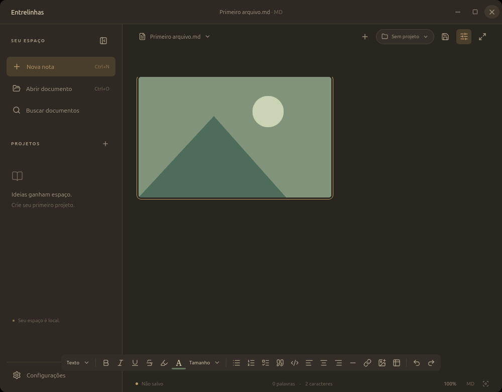
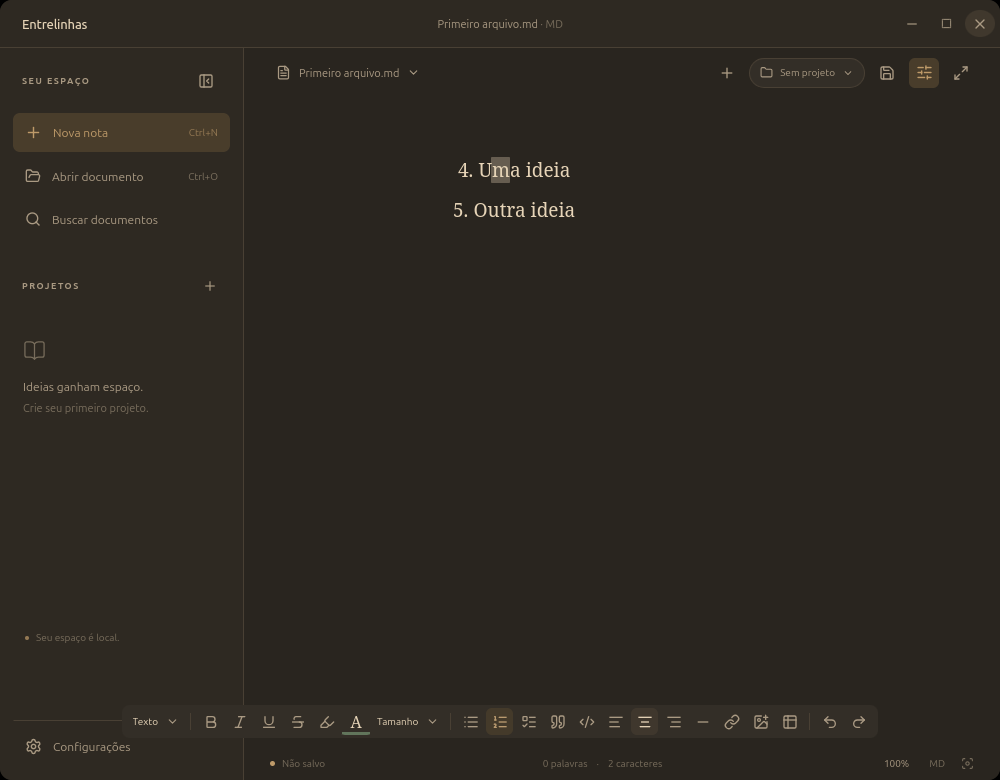
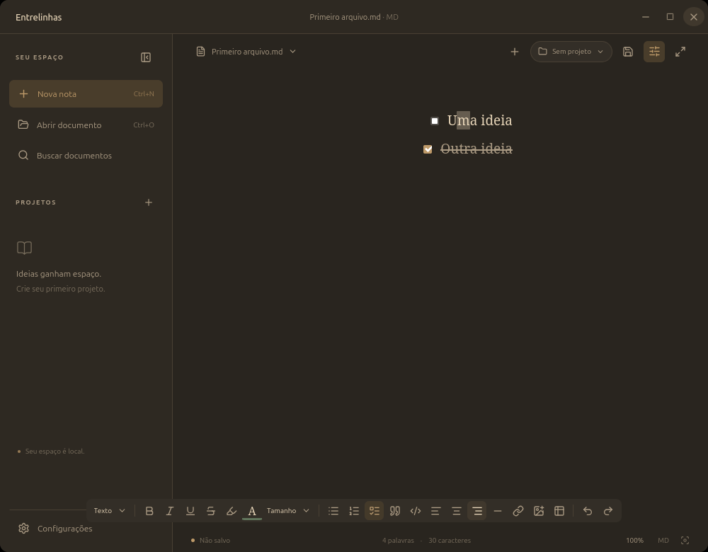
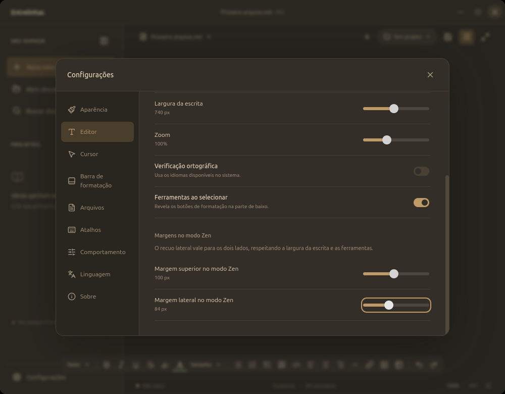
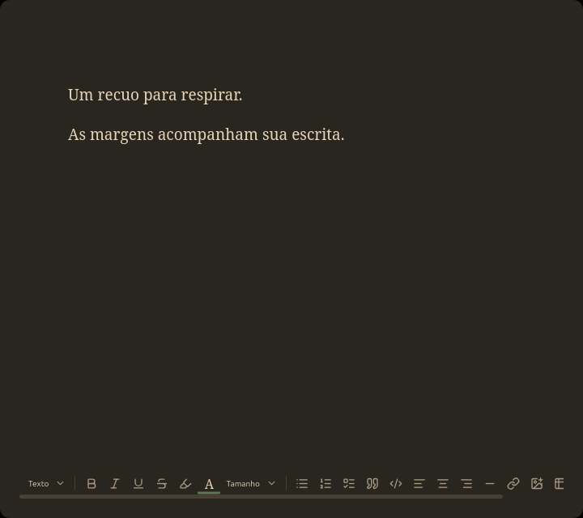
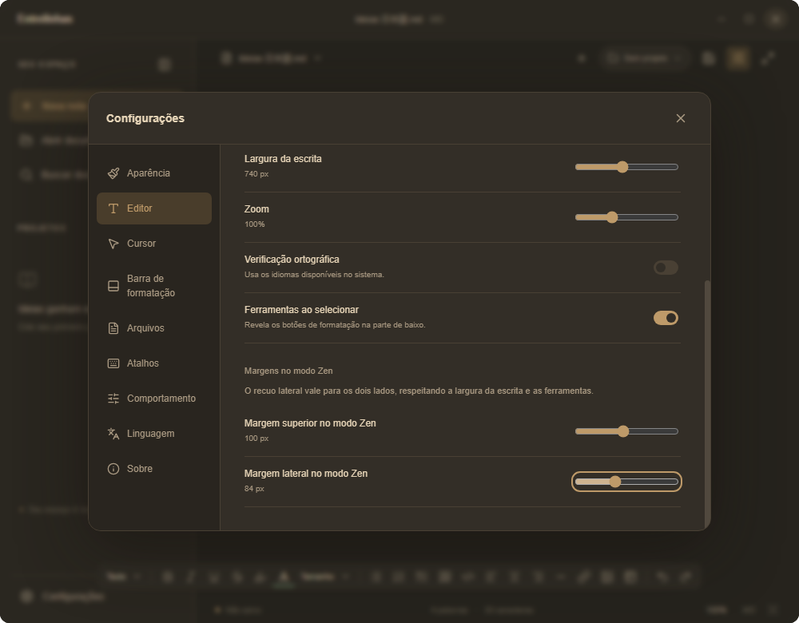

# Validação da 2.4.3-rc.1

Pré-release solicitada para teste antes da promoção à 2.4.3 estável. A 2.4.2 permanece como versão estável mais recente e no canal estável de atualizações.

## Alterações

- Imagens: áreas de arraste transparentes nas quatro bordas e nos quatro cantos, com cursor horizontal, vertical ou diagonal. Proporção e largura da página respeitadas, inclusive ao reduzir a janela. Desfazer/refazer sincroniza os atributos salvos e o tamanho visível. A seleção contorna a imagem, sem quadrados.
- Listas: números, marcadores e caixas de tarefas acompanham o texto ao centralizar ou alinhar à direita. O alinhamento é individual por item e continua após salvar/reabrir Markdown; listas aninhadas, numeração inicial e tarefas marcadas são preservadas. Documentos anteriores com alinhamento apenas no parágrafo são reconhecidos.
- Configurações → Editor: margem superior e margem lateral do modo Zen, independentes, de 16 a 200 px. Padrão de 56 px em ambas. O recuo lateral mínimo é simétrico; a largura da escrita, a barra lateral de formatação e a largura mínima utilizável também são respeitadas. Fora do Zen, a coluna normal continua usando suas preferências anteriores.
- Rótulos traduzidos nas nove variantes dos seis idiomas existentes. Fontes japonesas, chinesas simplificadas e tradicionais locais regeneradas com cobertura das novas mensagens.

## Evidências

Fonte da pré-release e testes finais: `f444cb83084b63c4311923b98bb35a23822e54e5`.

O pacote Linux foi compilado no `c1011288531140a934709539444744995ec8309f`. O commit final acrescenta apenas esperas e diagnóstico ao roteiro de testes; a comparação de `src`, `public`, `src-tauri` e dos manifestos confirma o mesmo código de aplicativo. `Linux-build.json` registra separadamente os commits de compilação, teste e publicação.

Instalador Windows: [execução 45301977277](https://github.com/Davi-Mascarenhas/entrelinhas/actions/runs/45301977277). Os testes Windows usam Windows Server 2025 e WebView2 em um perfil descartável; o teste manual desta prévia no Windows 11 ficará a cargo do usuário antes da promoção.

| Validação | Resultado |
| --- | --- |
| TypeScript e testes frontend | 234 testes em 27 arquivos |
| Rust Linux / Windows | 20 / 19 testes |
| Rustfmt, Clippy e formatação frontend | Aprovados |
| Aplicativo Linux de produção extraído do `.deb` | 74 verificações nativas |
| Atualizações Linux | 10 verificações, com o `.deb` final |
| Ctrl+clique Linux | 3 verificações com navegador de teste registrado no sistema |
| Instalador e aplicativo Windows | 58 verificações nativas |
| Novos fluxos em cada sistema | Oito bordas/cantos, limites da imagem, janela reduzida, desfazer/refazer; nove combinações de lista/alinhamento; margens por teclado e persistência |
| Recuo ao entrar/sair do Zen | Oito combinações de tamanho/lado dos projetos/posição das ferramentas |

No Linux, `scripts/test-desktop-direct.py` controla o mesmo WebKitWebDriver e o executável de produção diretamente, usando as capacidades equivalentes às do tauri-driver 2.1.0. Não há repetição automática de cliques ou digitação. A funcionalidade de injeção de endpoints de teste fica restrita ao executável debug separado dos testes de atualização.

Os relatórios, capturas reais com texto de teste e `SHA256SUMS` acompanham a pré-release. As assinaturas Ed25519 de atualização verificam pacote e versão; não são certificados Authenticode.

## Publicação e instalação local

- Pacote Debian com versão de controle `2.4.3~rc.1`, para que a futura `2.4.3` seja reconhecida como atualização.
- Pacote `.deb` e instalador `.exe` com assinaturas de atualização verificadas.
- Canal `preview` na `2.4.3-rc.1`; canal `stable` preservado na `2.4.2`. A consulta continua manual, com consentimento e confirmação explícita para instalar uma pré-release.
- Instalação Linux local atualizada atomicamente após a validação, com versão e SHA-256 conferidos. A atualização não reinicia janelas do usuário; a nova versão fica disponível para a próxima abertura.

## Capturas

